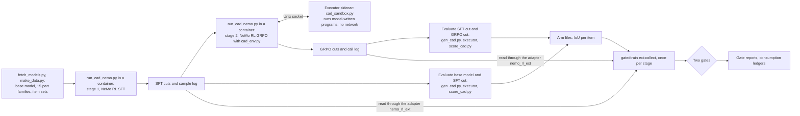

# gatedtrain recipe: NeMo RL CAD (SFT, then GRPO with a CadQuery environment)

This recipe teaches a small language model to write CadQuery programs (CAD scripts) from part descriptions, in two
stages, and lets [gatedtrain](https://github.com/gatedtrain/gatedtrain) decide whether each stage really improved it.
NeMo RL SFT trains Qwen2.5-Coder-0.5B-Instruct on ten procedurally generated part families. NeMo RL GRPO then trains
from that gated cut on all fifteen families with a custom CadQuery environment. gatedtrain gates the SFT cut against
the base model, and the GRPO cut against the SFT cut on the five families SFT never saw. The deciding metric is the
volumetric IoU of the generated solid with the reference solid, by a rule registered before training.

Every model-written program runs only in the executor container (`--network none`, uid 1000, no capabilities,
read-only root, CPU / memory / pids limits): as a sidecar of the GRPO trainer (Unix socket in a shared spool) and as
the execution step of each evaluation. The scoring step reads the references and runs no generated code.

A recipe is a ready-made external run for gatedtrain: the training code with its pinned environment, plus an
*adapter*, the small plugin through which gatedtrain reads the run's outputs. gatedtrain does not start the training;
you run it.

This is a prototype: the results below are one registered run, not a benchmark claim.

## How it works



`gatedtrain ext-launch` checks the run request and prints the container command; you run it. The steps, flags and
arm files are explained in gatedtrain's [External runs](https://gatedtrain.github.io/gatedtrain/external-runs/) guide.

## Result

Two registered stages of 60 steps each, one GPU. The GRPO stage took 0.44 GPU-hours (1.49 GPU-hours for the whole
recipe, including three superseded GRPO smokes). The deciding metric is `iou` on 300 items per stage:

| Stage | Baseline | Trained (cut 60) | Gate |
|---|---|---|---|
| SFT: base model to SFT cut, 10 SFT families | 0.397 | 0.985 | **PASS** under the original registration: +0.588, 95% cluster-bootstrap interval [0.536, 0.637] |
| GRPO: SFT cut to GRPO cut, 5 held-out families | 0.646 | 0.894 | **PASS** under the original registration: +0.248, 95% cluster-bootstrap interval [0.210, 0.289] |

The scorer changed after both gates ran (publication cleanup, hardening and renames). Re-judged with gatedtrain 0.3.0
under the amended registrations, both gates report INCONCLUSIVE with reason `post_hoc`, with every statistic equal.
The PASS verdicts are those of the original registrations. Training is not bit-reproducible: a re-run can differ from
these numbers by more than their intervals (see "Known limitations").

`RESULT.md` has the full record: the registrations, power, overlap with training, the impact queries, the
re-collections and the smoke re-runs. The gate files are under `results/2026-11-14/`.

## Setup

```bash
pip install "gatedtrain @ git+https://github.com/gatedtrain/gatedtrain@v0.3.0"   # the framework, at the release this recipe was tested with
pip install -e .                      # the adapter, into the environment that runs gatedtrain
cd runtime
python fetch_models.py                # the base model (needs huggingface-hub; network)
uv python install 3.12.16             # a standalone CPython tree (python-build-standalone; network)
(cd executor && UV_PYTHON_PREFERENCE=only-managed UV_LINK_MODE=copy uv sync --frozen --python 3.12.16)   # the executor venv
executor/.venv/bin/python -I make_data.py   # training shards and the items' reference meshes
docker --context gatedtrain build -t gatedtrain-cadexec:area6 -f executor/Containerfile executor/
```

The executor venv (cadquery, numpy) is mounted read-only into the executor, together with the interpreter tree it was
made from and the directory holding that tree. That tree must be a standalone CPython tree (python-build-standalone,
a directory named `cpython-<X.Y.Z>-<platform>`), which is what `uv python install` provides;
`UV_PYTHON_PREFERENCE=only-managed` keeps `uv sync` from picking a system interpreter such as `/usr/bin/python3.12`,
whose tree (`/usr`) cannot be mounted. The adapter's rows refuse a venv made from any other tree with a clear error
(`rows.py`, `standalone_tree_version`). Check the result with `grep home executor/.venv/pyvenv.cfg`: it must name
`.../cpython-3.12.16-linux-x86_64-gnu/bin`.

The trainer and generation containers use the NeMo RL family image `gatedtrain-a6-nemo-rl:1`, pinned in
`gatedtrain.families.nemo_rl` and built from gatedtrain's `containers/nemo-rl-uid1000/`. The executor image is this
recipe's (`runtime/executor/BUILD.md`).

The adapter finds the runtime at `runtime/` of this checkout (or `GATEDTRAIN_RECIPE_NEMO_RL_CAD_RUNTIME`). The runtime
and the interpreter tree the executor venv was made from (read from `runtime/executor/.venv/pyvenv.cfg`) are mounted
read-only at their own host paths, so those paths are also the ones the containers see. The two NeMo RL scripts run
the image's own interpreters; the executor scripts run the executor venv's. The runs' outputs go under the host's
gatedtrain output root (`<output_root>/nemo-rl-cad`); the GRPO run's spool is a sibling of its trainer output
(`<run>/train`, `<run>/spool`). `runtime/README.md` has the research notes, the trainer settings, the launch facts, the
executor sandbox and the decisions behind the metric.

The adapter locates `runtime/` from its own source tree (`src/gatedtrain_recipe_nemo_rl_cad/../../runtime`), which
exists only in a source checkout or an editable install (`pip install -e .`). After a non-editable install (a wheel),
set `GATEDTRAIN_RECIPE_NEMO_RL_CAD_RUNTIME` to the `runtime/` directory of a checkout.

Some runtime names predate the project's rename to gatedtrain and are kept because the published runs and the
committed metadata carry them: the hooks module `runtime/ptc_cad_hooks.py` (the adapter checks the run's
`hooks_sha256` against the file of that name beside the launched script), the runtime's own schema ids `ptc_mm.*`
(`cut.json`, `exec_meta.json`, the data and item-set metadata, whose hashes are registered) and the package list
`/etc/ptc-cadexec-packages.txt` written by the executor image's `RUN` instruction (the image is pinned by ID).

Note: the items' reference meshes (`items-*/ref/`) are regenerated by `make_data.py`; the committed item sets pin
their SHA-256, so a regeneration must reproduce them byte for byte to keep the registered item-set hashes.
The same holds for the three metadata files (`data/data_meta.json`, `items-sft/item_set_meta.json`,
`items-grpo/item_set_meta.json`). Their `generator.script_sha256` records the revision of `make_data.py` that generated
the data; the published script differs from it only in documentation (RESULT.md, "Publication cleanup"), so its own
SHA-256 differs. `make_data.py` therefore compares what it generated with the committed metadata: when everything
except that one hash is identical, it keeps the recorded hash and the committed files come out unchanged (it prints
`metadata reproduced byte for byte`); any other difference writes fresh metadata with the script's own hash, which
then no longer matches the registrations. `git status runtime/` after the run shows which case occurred.

## Layout

| Path | What |
|---|---|
| `src/gatedtrain_recipe_nemo_rl_cad/` | the gatedtrain adapter `nemo_rl_ext` (`adapter.py`) and its registry rows (`rows.py`), registered through the `gatedtrain.adapters` entry point |
| `runtime/` | what runs in the containers: `run_cad_nemo.py` (NeMo RL launcher, both stages), `ptc_cad_hooks.py` (cuts, sample log, run record), `cad_env.py` (the GRPO environment, a client of the executor), `gen_cad.py` (vLLM generation), `score_cad.py` and `geom_metrics.py` (scoring), the host-side `fetch_models.py`, `make_data.py` and `cad_families.py`, the CPU pilot `sft_cpu_pilot.py`, the pins (`models/MODELS.json`), the data metadata and the two registered item sets (`items-sft/`, `items-grpo/`) |
| `runtime/executor/` | the B18 executor: `cad_sandbox.py` (serve, run-batch, self-test), `cad_protocol.py` (wire protocol, program extraction, reward), `run-executor.sh` (prints the three executor `docker run` commands), its `Containerfile` and `BUILD.md`, and the venv's `pyproject.toml` and `uv.lock` (cadquery 2.8.0) |
| `tests/` | the adapter's tests on fixture runs (no GPU, no model, no CadQuery needed) and gatedtrain's conformance check |
| `results/2026-11-14/` | the gate files of both published stages (`gate-sft/`, `gate-grpo/`; redacted copies, host paths replaced by `<data-root>`) and the CPU pilot's evidence the tests read (`pilot/`) |

## Tests

```bash
python -m unittest discover -s tests -t tests
```

The tests pin the runtime and the interpreter tree to a neutral layout under a temporary directory in `build/` (set
before gatedtrain loads the rows). Tests that read regenerated files (the base model, the training shards, the executor
venv) skip when they are absent; `GATEDTRAIN_RECIPE_NEMO_RL_CAD_RUNTIME` points them at a complete runtime.

The gate files under `results/`, the runtime notes, code comments, tests and `RESULT.md` cite records of the
framework's development: the maintainers' decision record (`decisions/MVP-MULTIMODAL.md`, "Area 6 decisions"), the
framework's review rounds ("review 9 L2", "review 11", "Review 11 H1") and ids of its internal issue lists
(`G-21`). Those records are not published.

## Data and licenses

This repository is licensed under Apache-2.0 (`LICENSE`). It ships no third-party code or data; what the recipe uses
is downloaded or built by the user:

| What | Source and pin | License | Notes |
|---|---|---|---|
| Base model Qwen2.5-Coder-0.5B-Instruct | `Qwen/Qwen2.5-Coder-0.5B-Instruct` @ `ea3f2471cf1b1f0db85067f1ef93848e38e88c25` (`runtime/fetch_models.py`, files checked by SHA-256 in `runtime/models/MODELS.json`) | Apache-2.0 (model card; the `LICENSE` file in the repository) | Qwen team, Alibaba Cloud. The trained cuts are derivatives of it |
| Training data and item sets | generated by `runtime/make_data.py` from 15 parametric part families (`runtime/cad_families.py`) | Apache-2.0 (this repository) | no third-party data; the committed item sets (`runtime/items-*/items.jsonl`) and the pilot outputs under `results/` are this project's own |
| CadQuery 2.8.0 | PyPI, through `runtime/executor/uv.lock` (installed into the executor venv, not redistributed) | Apache-2.0 | |
| cadquery-ocp 7.9.3.1.1 (OCP bindings with Open CASCADE Technology 7.9.3) | PyPI, through `runtime/executor/uv.lock` | bindings Apache-2.0; the bundled OCCT libraries LGPL-2.1 with the Open CASCADE exception | not redistributed here |
| casadi 3.8.2 | PyPI, through `runtime/executor/uv.lock` (a cadquery dependency) | LGPL-3.0-or-later | installed at runtime into the executor venv, not redistributed here |
| nlopt 2.11.0 | PyPI, through `runtime/executor/uv.lock` (a cadquery dependency) | LGPL-2.1-or-later as a whole (some parts MIT or BSD-style) | installed at runtime into the executor venv, not redistributed here |
| Other executor dependencies (numpy, scipy, vtk, ...) | `runtime/executor/uv.lock` | their own licenses (BSD-style and similar) | not redistributed here |
| NeMo RL | github.com/NVIDIA-NeMo/RL @ `4f39fd86289a2ffd5aaf5d202702f7fd7185c924` | Apache-2.0 | used unmodified inside its image |
| Trainer and generation image | `nemo-rl:4f39fd8` built from NeMo RL's `docker/Dockerfile` at that commit (base `nvcr.io/nvidia/cuda-dl-base:26.05-cuda13.2-devel-ubuntu24.04`, image ID `sha256:8cd5b714ea91ec7ea9a976c75b0ae6f6932140cf7a8aea803100de6331a2113a`), then gatedtrain's `containers/nemo-rl-uid1000/` on top (`gatedtrain-a6-nemo-rl:1`, image ID `sha256:7a4078e70b28cc6de622fa3cf25c7596c52337fa3f1779488b402c5fa1c74e69`, file ownership changes only) | NeMo RL Apache-2.0; the CUDA base image under NVIDIA's container license terms | built locally, not redistributed |
| Executor image | `runtime/executor/Containerfile`: `docker.io/library/ubuntu:noble-20260930.1` (digest pinned) plus five Ubuntu packages from the 2026-10-29 snapshot | Ubuntu packages under their own licenses | built locally (`runtime/executor/BUILD.md`) |

Load only model cuts and NeMo RL resume state (`nemo/checkpoints/`) that you produced yourself: NeMo RL's resume
state is a torch distributed checkpoint, which unpickles on load.

## Known limitations

- The GRPO smoke's peak GPU memory sits at the smoke's 22.5 GB limit: the published smoke peaked at 22.27 GB, and
  a re-run on the published path peaked at 23.39 GB (24.70 GB from another SFT cut), so a re-run may fail the
  smoke's `gpu_memory` check.
- Training is not bit-reproducible: a re-run gives an SFT cut with other weights, and the GRPO baseline arm (the SFT
  cut on `items-grpo`) varies widely between such cuts.

Both are described with their numbers in `RESULT.md`, "Re-run of the smokes (2026-11-18)".

## License

This repository is licensed under the Apache License, Version 2.0 (`LICENSE`); see `NOTICE`. Third-party models,
data, packages and images used by the recipe are not included; their licenses are listed under "Data and licenses"
above. Names of third-party projects and products are trademarks of their owners; this project is not affiliated with
or endorsed by them.
